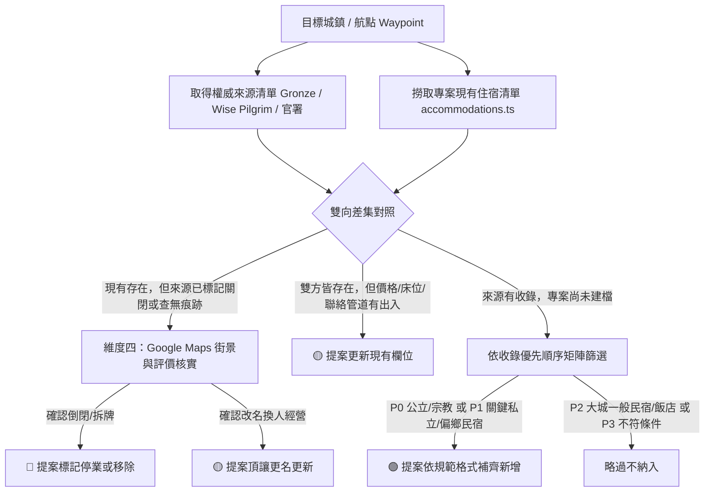

# 全路線朝聖住宿雙向稽核與補齊技能 (Camino Accommodation Auditor & Synchronizer)

本技能專門用於排查、補齊與維護朝聖之路規劃專案中的住宿資料庫（[`src/data/accommodations.ts`](file:///d:/file/practice/camino-planner/src/data/accommodations.ts)），**全方位適用於本專案收錄之所有朝聖路線（涵蓋法國之路、葡萄牙之路中央線/海岸線、北方之路、原始之路、世界盡頭延伸線等所有主線與分支路線）**。

本技能採用**「雙向對齊機制（Two-Way Reconciliation）」**：
1. **正向稽核（現有 $\rightarrow$ 來源）**：排查已歇業、拆牌、重複建檔或頂讓改名的「幽靈住宿點」，並修正過期價格與床位。
2. **逆向探勘（來源 $\rightarrow$ 現有）**：比對國際權威指南，發掘各航點（Waypoint）尚未收錄的公立、宗教、關鍵私立庇護所或偏鄉救援民宿（Casa），依優先等級精準補齊。

---

## 核心準則與安全防線 (Core Principles)

> [!IMPORTANT]
> 1. **全路線一體適用**：本技能適用於所有已建置與未來擴充之朝聖路線，查證規格一致，嚴禁單一路線差別待遇。
> 2. **嚴禁直接未授權改動程式碼**：在使用者審閱並明確同意變更報告之前，絕對不可直接修改 [`src/data/accommodations.ts`](file:///d:/file/practice/camino-planner/src/data/accommodations.ts)。
> 3. **嚴格禁止使用 Python 進行驗證**：
>    - 本專案為純 Node.js / TypeScript 生態系（本機未安裝 Python）。
>    - 嚴禁呼叫 `python`、`python3` 或相關腳本。所有資料健康度稽核、測試與驗證均須透過 Node.js 工具鏈與 Vitest 執行。
> 4. **嚴格區分「季節性休業」與「永久停業」**：
>    - 朝聖之路多數庇護所僅在每年 4 月～10 月開放，冬季關閉（Cerrado en invierno / por temporada）。**此類住宿非幽靈住宿，不可剔除！**
>    - 僅有標註「永久停業（Cerrado definitivamente）」或查證實體建築已廢棄/改為民宅者，方可判定為幽靈停業點。
> 5. **更名與轉手防呆**：
>    - 若舊庇護所由新團隊接手改名，應更新原物件之 `name`、`chineseName` 與聯絡方式，並在 `notes` 保留舊有名稱（如「原 Albergue XYZ，於 2024 年更名接手」），避免使用者重複建檔或遺失歷史資料。

---

## 雙向對齊流程架構 (Two-Way Reconciliation Matrix)

針對特定城鎮/航點進行查核時，依循以下雙向對齊流程：



---

## 住宿收錄優先順序矩陣 (Inclusion Priority Matrix)

為防止朝聖大城之一般觀光飯店大量湧入導致資料庫膨脹，補齊缺漏住宿時必須嚴格遵守以下優先順序：

| 優先等級 | 適用住宿型態 | 判定條件與收錄原則 | 專案型別 mapping |
| :---: | :--- | :--- | :--- |
| **P0**<br>（核心骨幹必補） | 公立庇護所<br>教會/堂區庇護所<br>傳統隨喜庇護所 | • 各城鎮之公立（Municipal / Xunta）<br>• 堂區（Parroquial）<br>• 傳統非營利/隨喜接待（Donativo / Acogida Tradicional） | `MUNICIPAL`<br>`PAROCHIAL`<br>`PRIVATE` |
| **P1**<br>（強烈建議補） | 知名私立朝聖庇護所<br>**偏鄉孤島救援民宿** | • 評價良好之私立朝聖庇護所（Albergue Privado）<br>• **偏鄉民宿（Casa Rural / Casa de Huéspedes）**：該航點**無任何 Albergue**，為當地唯一或稀缺之過夜點 | `PRIVATE`（有床位）<br>`HOSTEL` / `HOTEL`（純獨立房） |
| **P2**<br>（次要選補） | 大城鎮常規民宿<br>平價客棧 / 青年旅館 | • 大城鎮（資源充裕）之特色鄉村民宿、客棧（Hostal / Pension）<br>• 提供雙人房/獨立房需求之選配項目，視代表性選補 | `HOSTEL`<br>`HOTEL` |
| **P3**<br>（嚴禁收錄） | 純觀光公寓 / 商業飯店 | • 遠離朝聖主線無接駁之純商務旅館<br>• 日租公寓（Apartamento turístico）或度假別墅 | *不予收錄* |

---

## 民宿（Casa）與特殊旅宿之型別對應指引 (Type Mapping Guide)

專案定義之 [`AccommodationType`](file:///d:/file/practice/camino-planner/src/types/camino.ts#L9) 為：`'MUNICIPAL' | 'PAROCHIAL' | 'PRIVATE' | 'HOSTEL' | 'HOTEL'`。

新增缺漏旅宿時，應依照實體營運模式映射型別：
1. **Casa Rural / Casa de Huéspedes / Gîte**：
   - 若備有**朝聖者上下舖/單人床位（Litera / Dormitorio）** $\rightarrow$ 映射為 `'PRIVATE'`。
   - 若**僅提供獨立雙人房/客房（Habitación privada）** $\rightarrow$ 映射為 `'HOSTEL'` 或 `'HOTEL'`。
2. **民宿（Casa）之關鍵欄位約束**：
   - 由於民宿房間數稀少（通常僅 3～8 間），補齊時**必須優先採集其預訂與聯絡管道**（`bookingComUrl`、`whatsapp`、`phone` 或 `officialWebsiteUrl`）。
   - 於 `notes` 必須註記其特性（例：「純獨立房無上下舖，房間數少建議提早預訂」）。

---

## 全路線多維權威查證情報源 (Verification Sources)

1. **維度一：Gronze.com 西班牙朝聖第一權威指南**
   - 核實住宿營運狀態、床位數、最新年度價格、廚房配置。
   - 識別 `Cerrado definitivamente`（停業）、`Cerrado por reformas`（整修）、`Cerrado en invierno`（冬季休業）。
2. **維度二：Wise Pilgrim 國際朝聖情報庫**
   - 取得國際朝聖者社群電話、WhatsApp 預約管道與即時回報。
3. **維度三：官方公立網絡與官署營業執照登記 (Xunta & 各區官署)**
   - **加利西亞全境**：核對 Xunta de Galicia 公立庇護所網絡（Rede Pública）與自治區觀光營業登記執照（REAT）。
   - **葡萄牙境內**：核對 Turismo de Portugal 與葡萄牙朝聖協會認證名冊。
   - **西班牙各自治區**：巴斯克、坎塔布里亞、阿斯圖里亞斯、卡斯提亞-雷昂、納瓦拉、拉里奧哈之觀光登記。
4. **維度四：Google Maps 即時商號與 Street View 實景街景**
   - 檢核地標是否標記「永久停業」、近 6 個月評價與街景招牌。

---

## 幽靈住宿分類標準 (Classification)

| 分類代碼 | 判定條件 | 建議處置措施 |
| :--- | :--- | :--- |
| `GHOST_NON_EXISTENT` | Wise Pilgrim、Gronze、官署登記與 Google Maps 均查無痕跡，純屬誤植或幽靈登錄。 | 提案完全自陣列中移除。 |
| `GHOST_PERMANENTLY_CLOSED` | Gronze 或 Wise Pilgrim 明確標記停業，且 Google Maps 確定永久關閉或街景已拆牌。 | 提案自陣列中移除（或標記關閉）。 |
| `GHOST_RENAMED` | 同一地址/電話已轉由新庇護所經營。 | 更新名稱與資料，於 `notes` 保留「原稱：XXX」。 |
| `GHOST_DUPLICATE` | 因多國語言翻譯造成重複建檔。 | 整併為單一項目，中文與別名合併至備註。 |

---

## 變更報告標準流程 (Mandatory Change Report)

在進行任何程式碼更動前，**必須先向使用者輸出變更報告**，並等待使用者明確確認執行。

### 變更報告標準範本：
```markdown
### 住宿變更報告：[路線名稱] - [城鎮航點代碼與名稱]

#### 1. 雙向對齊現況總覽
- 專案既有收錄：X 間
- 權威來源收錄：Y 間
- 異動提議：新增 [A] 間 / 修訂 [B] 間 / 移除停業 [C] 間

#### 2. 詳細變更清單
- 🟢 **【新增 MISSING_ADDED】(優先級: P0/P1)**
  - 名稱：[住宿原名] ([中文名稱])
  - 型別：[AccommodationType] | 床位：[N] | 價格：[€]
  - 聯絡管道：[電話 / Booking / WhatsApp]
  - 收錄理由：[例：該城鎮唯一之偏鄉民宿救援點 / 漏收之公立庇護所]
- 🟡 **【修訂 DRIFT_UPDATED / RENAMED】**
  - 項目：[ID] [住宿名稱]
  - 異動內容：[價格更新 €12 -> €15 / 頂讓改名]
- 🔴 **【停業 GHOST_REMOVED】**
  - 項目：[ID] [住宿名稱]
  - 佐證來源：[Gronze 標記 Cerrado definitivamente / 街景已拆牌]

#### 3. 程式碼 Diff 預覽
(精準列出前後幾行程式碼變更)

#### 4. 預計執行之驗證指令
- `node .agent/skills/camino-accommodation-auditor/scripts/audit_accommodations.mjs`
- `npm run test`
- `npm run build`
```

---

## 驗證與測試流程 (Verification & Testing)

每次更新住宿資料後，**一律使用 Node.js / TypeScript 工具鏈進行驗證（嚴禁使用 Python）**：

1. **住宿資料集健康度稽核（Node.js 腳本）**：
   ```bash
   node .agent/skills/camino-accommodation-auditor/scripts/audit_accommodations.mjs
   ```
   - 自動檢驗重複 ID、全路線有效航點對齊、價格/床位數值合理性及網址格式。

2. **資料完整性單元測試（Vitest）**：
   ```bash
   npm run test
   ```

3. **TypeScript 型別與生產環境編譯檢查**：
   ```bash
   npm run build
   ```
