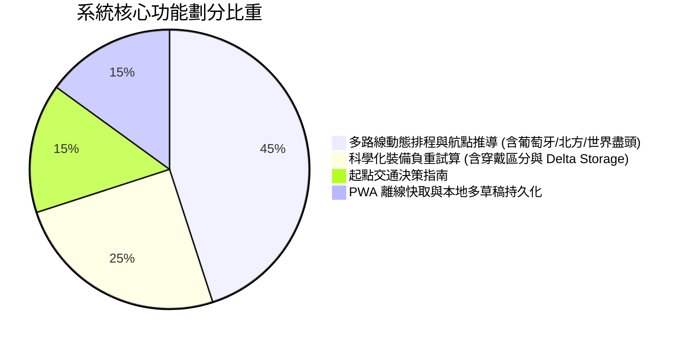

# 🇪🇸 Camino Taiwan Guide 產品需求規格書 (PRD v1.2)

---

## 1. 產品目標與願景 (Product Goals & Vision)

1. **消除行前交通焦慮**：提供專為台灣出發者設計的起點（SJPP 等）交通轉乘決策指引與換乘防呆提醒。
2. **實現動態自適應排程**：以城鎮航點鏈結為基礎，支援使用者依體力自訂天數、插入休息日，並在現場變更停靠點時自動動態重新平衡後續里程。
3. **第一天越嶺安全守護**：內建「拿破崙之路」與「瓦卡洛斯之路」雙路線切換機制，並具備 11/1~3/31 冬季強制封閉防護警告。
4. **科學化裝備負重與實戰避坑**：提供裝備建議清單、參考重量區間與台灣實戰備註，區分「背包負重」與「身上穿戴」，嚴格把關體重 10% 負重警戒線。
5. **離線優先與零門檻使用**：透過 Vue 3 PWA 與本機儲存機制，確保在西班牙山區斷網環境下依然能 100% 流暢查閱與操作。
6. **極低成本永續營運**：採用純前端 Jamstack 靜態託管（主機維護成本 NT$ 0），結合交通購票、網卡推薦與 Google 廣告插槽（環境變數開關控制，未啟用時完全隱形）達成收支平衡。
7. **多經典路線支援與模組化擴充**：支援法國之路（Camino Francés）、葡萄牙之路（Camino Portugués，波多起點支援中央線與海岸線雙分支）與北方之路（Camino del Norte，標準版），採獨立草稿保存機制，切換路線進度不遺失。
8. **世界盡頭全域延伸旅程無縫銜接**：所有路線抵達聖地牙哥終點後，皆可無縫外掛「世界盡頭（Finisterre / Muxía）」延伸段，並支援 5 種走向與雙向環線自選。

---

## 2. MVP 使用者故事與驗收條件 (User Stories & Acceptance Criteria)

### 【故事一：智慧排程與現場動態重新平衡】
> **作為一名** 第一次走法國之路的台灣朝聖者，  
> **我想要** 輸入出發日期與預計天數（28~36 天），並能在地圖/清單上自由插入休息日或在現場修改今日停留城鎮，  
> **以便於** 系統能自動重新平衡後續天數的每日里程，隨時掌握最新行程。

* **驗收條件 (AC)**：
  1. 系統預設提供 33 天經典分段，支援使用者增減總天數。
  2. 點擊「+ 插入休息日（Rest Day）」時，當天步行里程計為 0 km，後續所有分段日期自動順延 1 天。
  3. 當使用者變更任一天的「結束城鎮」時：
     - 自動將隔天的「起點城鎮」更新為相同地點。
     - 自動重新計算兩天的里程與爬升高度。
  4. **Day 1 雙路線切換（法國之路專屬）**：
     - 若當前路線為法國之路，提供「拿破崙之路（爬升 1250m）」與「瓦卡洛斯之路（爬升 850m）」切換選項。
     - 若出發日期落在 11 月 1 日至 3 月 31 日，系統強制鎖定瓦卡洛斯之路並跳出冬季封閉警告。
     - 非法國之路時，該控制面板自動由該路線專屬分支面板取代或隱藏，領域邊界清楚隔離。
  5. 所有運算 100% 於前端本機毫秒級完成，並持久化存入 `localStorage`。

---

### 【故事二：起點交通轉乘決策（當前版本：法國之路 SJPP）】
> **作為一名** 剛買好歐洲機票的朝聖者，  
> **我想要** 選擇抵達城市（巴黎 CDG / 馬德里 MAD / 巴塞隆納 BCN），  
> **以便於** 獲得前往起點（現階段為 SJPP）的最佳鐵公路轉乘步驟、耗時、票價與換乘防呆提醒。

* **驗收條件 (AC)**：
  1. 提供巴黎、馬德里、巴塞隆納至 SJPP 的直覺步驟卡片，頂端清楚標示「當前收錄：法國之路起點交通指南」（葡萄牙波多、北方伊倫起點納入後續版本）。
  2. 每條方案明確標註：交通工具（TGV / Renfe / ALSA 巴士）、預估耗時、預估票價區間、開行月份限制。
  3. 提供官方購票平台（SNCF / Renfe / Omio）外連連結。

---

### 【故事三：科學化裝備負重與實戰避坑】
> **作為一名** 正在打包背包的朝聖者，  
> **我想要** 輸入體重、勾選裝備並輸入自行秤重的克數，  
> **以便於** 系統能精準計算「背包淨負重」，並提醒我是否超過體重的 10%。

* **驗收條件 (AC)**：
  1. 輸入體重（kg），系統自動計算背包負重警戒線（體重 × 10%）。
  2. 裝備項目標註「參考重量區間（如 150g~300g）」與「台灣實戰選購建議」，使用者可自行填寫真實秤重克數。
  3. **攜帶狀態切換**：移除傳統核取方塊，點擊品名即可切換是否攜帶；未勾選項目呈現淡灰色與刪除線（`line-through`）。
  4. **漸進式收合卡片**：裝備列預設折疊外語名稱與控制項，僅顯示中文品名與該項重量小計（如 `550g`）；點擊展開後可檢視英西雙語對照、調整單件克數與增減數量。
  5. **穿戴狀態切換**：提供「穿在身上（`isWornOnBody`）」膠囊徽章切換開關，具備事件獨立攔截；標記穿戴者（如腳上的登山鞋）**不計入背包負重**。
  6. **自訂裝備擴充**：支援新增自訂項目，並可選填西班牙文名稱（`spanishName`），以便於朝聖途中或當地商店外語溝通。
  7. **官方資料庫即時同步**：採用差異化儲存架構（Delta Storage），當系統發布新版避坑指南或名稱修正時，已使用者無須重置快取即可即時同步，並完整保留使用者的自填重量與勾選狀態。
  8. 背包總負重超過 10% 顯示紅色警告；低於 10% 顯示綠色安全。
  9. 關鍵項目（睡袋需求、登山杖托運、床蟲防治噴霧）附帶實戰說明彈窗或 Tooltip。

---

## 2.1 擴充使用者故事 (Multi-Route & Extensions)

### 【故事四：多經典路線規劃與分支切換】
> **作為一名** 正在探索不同朝聖體驗的使用者，  
> **我想要** 在法國之路、葡萄牙之路（中央線／海岸線分支）與北方之路（經典版）之間自由切換，  
> **以便於** 各自規劃行程且原路線的排程草稿與天數設定能完整獨立保存，不會因切換而遺失。

* **驗收條件 (AC)**：
  1. 導覽列與排程頁面提供直覺的路線切換選單（法國之路、葡萄牙之路、北方之路）。
  2. **葡萄牙之路波多雙分支**：
     - 起點預設為波多（Porto，約 240km）。
     - 支援「中央線（Camino Central）」與「海岸線（Camino de la Costa）」分支切換，航點與里程自動動態調整，並於 Redondela 銜接共線匯合至聖地牙哥。
  3. **北方之路經典版**：
     - 起點為伊倫（Irún），經 Ribadeo、Sobrado dos Monxes，於 Arzúa 匯入法國之路終抵聖地牙哥（約 825km）。
  4. **多路線獨立草稿持久化**：
     - 系統為每條路線各自維護獨立的排程狀態（起點、目標天數、自訂停留點、休息日），切換路線時無痛載入該路線進度，杜絕資料相互污染。
  5. **庇護所空狀態優雅降級**：
     - 若目標路線之航點尚在陸續建立住宿資料庫，卡片與彈窗嚴格做好空狀態處理（顯示「官方清單擴充中」與 Gronze 站點查詢連結），絕不拋出 `undefined` 錯誤或頁面死當。

---

### 【故事五：世界盡頭全域延伸旅程規劃】
> **作為一名** 抵達聖地牙哥後想繼續前往大西洋海角的朝聖者，  
> **我想要** 為任何主路線勾選是否延伸走向世界盡頭，並自由決定造訪菲尼斯特雷（Finisterre）與穆希亞（Muxía）的偏好，  
> **以便於** 自動計算延伸段所需天數、每日里程與整體累計總旅程。

* **驗收條件 (AC)**：
  1. 排程設定提供「世界盡頭延伸段（Prolongación a Fisterra y Muxía）」選單，支援 5 種走向：
     - `NONE`：不延伸（於聖地牙哥劃下句點）
     - `FINISTERRE_ONLY`：僅前往菲尼斯特雷（Santiago ➔ Negreira ➔ Olveiroa ➔ Finisterre，約 90km）
     - `MUXIA_ONLY`：僅前往穆希亞（Santiago ➔ Negreira ➔ Olveiroa ➔ Muxía，約 86km）
     - `BOTH_FINISTERRE_FIRST`：先菲尼斯特雷後穆希亞（Santiago ➔ Finisterre ➔ Lires ➔ Muxía，約 119km）
     - `BOTH_MUXIA_FIRST`：先穆希亞後菲尼斯特雷（Santiago ➔ Muxía ➔ Lires ➔ Finisterre，約 119km）
  2. 當啟用延伸段時，排程總天數與總里程自動動態接續推算，並將延伸段航點與庇護所無縫嵌入排程清單底部。
  3. **聖地牙哥停留休整日**：
     - 提供「聖地牙哥休整天數（0~2 天）」選項，主線抵達聖地牙哥後可原地停留休整，延伸段出發日期與天數自動順延。
  4. **延伸段調配邊界保護**：
     - 世界盡頭分段更換結束點時，候選航點嚴格隔離限制於世界盡頭拓撲節點範圍內，防止倒流回主線城鎮。

---

### 【故事六：權威資料來源與全路線途經城鎮對齊 (Gronze Locality Alignment)】
> **作為一名** 正在規劃或行走朝聖之路（如葡萄牙之路或北方之路）的使用者，  
> **我想要** 系統列出的沿途城鎮與村落 100% 依照西班牙權威指南 Gronze.com 的官方目錄完整收錄，  
> **以便於** 不僅能看到每日建議大站，還能靈活更換至特色中繼聚落過夜，並精確掌握各村落的補給機能。

* **驗收條件 (AC)**：
  1. 所有主路線與分支（葡萄牙中央線 60+ 個、海岸線 50+ 個、法國之路 70+ 個等）途經城鎮必須完全依照 Gronze.com 官方目錄無一遺漏地收錄。
  2. 每個航點均包含當地官方名稱、葡/西文名稱、台灣繁體中文標準譯名、精確經緯度座標、海拔高度。
  3. 明確標記各城鎮之機能屬性：是否有庇護所（`hasAlbergue`）、藥局（`hasPharmacy`）、超市（`hasSupermarket`）與是否為主要大城（`isMajorCity`）。
  4. 航點累計里程單調遞增，全線總長由航點資料精確動態推導，並與官方標準完全吻合。

---

## 2.2 系統可靠度與測試驗收需求 (Quality & System Reliability)

1. **舊版本機快取無損遷移（Zero-Break Migration）**：
   - 既有使用者自舊版單一排程升級時，系統啟動時必須自動偵測並將既有 `config` 與 `stages` 封裝遷移至 `drafts.frances`。
   - 嚴格防止持久化還原時將新結構覆蓋為 `undefined`，達成零白畫面、零歷史進度遺失。
2. **自動化測試金字塔驗收（Vitest）**：
   - **資料完整性測試**：驗證所有航點 ID 具備正確命名空間前綴（`frances:*` 等）、全線里程單調遞增無跳空、葡萄牙雙分支於 Redondela 正確匯流。
   - **核心運算迴歸測試**：驗證法國之路 33 天基準計算結果重構前後完全一致，且世界盡頭 5 種走向之日期連續性與里程加總 100% 精準。
   - **快取遷移測試**：以單元測試模擬舊版 localStorage schema 還原，驗證自動遷移邏輯與草稿隔離性。

---

## 3. 功能範疇劃分 (Scope & Roadmap)

